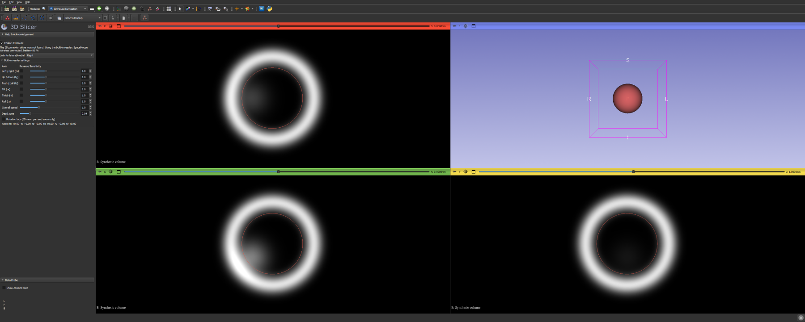
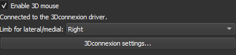
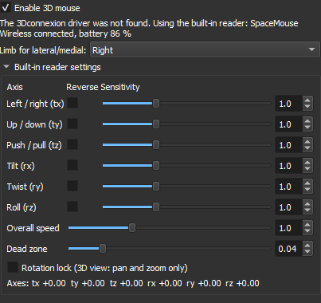

# 3D Mouse Navigation

A 3D Slicer extension (module **MouseNav3D**, "3D Mouse Navigation", category Utilities) that lets a 3D mouse move Slicer's 3D view and slice views: rotate, pan and zoom the view under the mouse pointer, plus anatomical view presets. Nothing else in the scene is touched. It works with 3Dconnexion SpaceMouse devices.

Licence: Apache-2.0 (`LICENSE.txt`); the navigation-library interface file is LGPL-2.1-or-later, see Licences and attribution below.



## What it does

- **3D view**: rotate, pan and zoom about the centre of the visible data, smooth, with no overshoot on release.
- **Slice views**: pan; push and pull step through the slices one plane at a time. Zoom in a slice view stays on Slicer's own mouse wheel or right-drag.
- **The view under the mouse pointer moves.** Slicer never moves while another program is the active application.
- **Anatomical views**: Anterior, Posterior, Left, Right, Superior, Inferior, Lateral, Medial and Reset view, named for the patient (see below).
- **View only**: the extension changes cameras and slice positions, never data, nodes or files. It sends no information anywhere, downloads nothing, and contains no compiled code or third-party binaries.

## Install

There are two ways to install the extension before it is listed in Slicer's Extensions Manager. Use one of them, not both. Both files come from the same build:

- `python tools/package_extension.py [destination folder]` writes the **extension package**, a zip named like `34645-win-amd64-MouseNav3D-git<commit>-<date>.zip` (default folder `dist/`). It prints which Slicer it is built for.
- `python tools/package_test_build.py <destination folder>` writes the home test package: a folder `MouseNav3D_test_<date>` (with an `INSTALL.txt` that names the file for each way), the same folder as `MouseNav3D_test_<date>_direct-install.zip`, and the extension package next to them and inside the folder. It prints both install routes.

### (a) Extensions Manager: Install from file

1. If you installed with (b) before, first remove the `MouseNav3D` folder from Edit > Application Settings > Modules (Additional module paths) and restart Slicer, so that only one copy of the module is loaded.
2. In Slicer open View > Extensions Manager, click "Install from file..." and choose the **extension package** zip (`34645-...-MouseNav3D-git...zip`).
3. Restart Slicer. Open the module at Modules > Utilities > 3D Mouse Navigation. It is listed under the Extensions Manager's installed extensions and can be uninstalled there.

The package is built for Slicer 5.12.x; `--slicer-version` builds it for another Slicer version. It is tested on Windows. Linux uses the same zip and layout and is expected to work, but is untested: the content is pure Python, and Slicer takes the operating system, architecture and revision from the running Slicer, not from the package. Outside macOS the revision (`--slicer-revision`) only changes the file name. macOS needs a different layout tied to one Slicer revision (`--os macosx`, untested). For another Slicer version or for macOS, install from the Extensions Manager's catalogue once the extension is listed, or use (b).

Only the extension package works here. The direct-install zip is a plain folder copy; Install from file refuses it with "No extension description found in archive".

### (b) Direct install (install_dev.py)

1. If the extension is installed through the Extensions Manager (a), uninstall it there first and restart Slicer, so that only one copy of the module is loaded.
2. Unpack `MouseNav3D_test_<date>_direct-install.zip` (or use the `MouseNav3D_test_<date>` folder, or a clone of this repository).
3. In Slicer open View > Python Console and paste the line that `tools/package_test_build.py` printed (it is also in the folder's `INSTALL.txt`). The line contains the package's full path; use it as printed, or change the path if you moved the folder:

   ```
   p = r"<full path to the package>\tools\install_dev.py"; exec(open(p).read(), {"__file__": p})
   ```

   It adds the `MouseNav3D` folder to Slicer's additional module paths (kept for later sessions) and loads the module without a restart. Open it at Modules > Utilities > 3D Mouse Navigation.

### Later: the Extensions Index

The repository is prepared for the Extensions Index (`docs/extensions-index/MouseNav3D.json`; steps in `docs/extensions-index/SUBMIT.md`). Once accepted, install "MouseNav3D" from Slicer's Extensions Manager for any Slicer version and OS the index builds.

Switching from (b) to the index: first remove the `MouseNav3D` folder from the additional module paths, as in (a) step 1.

A newly installed module starts the 3D mouse after a restart of Slicer, or as soon as its panel is opened.

## Two ways it drives the views

### Driver mode (3Dconnexion software installed)

With the 3Dconnexion driver (3DxWare) running, the extension describes the view under the mouse to the driver through the 3Dconnexion Navigation Library (Windows, Mac), and the **driver** computes the motion, smoothing and settings. Sensitivity, speed, axis reversal and button assignments are therefore set in 3Dconnexion's own app, not in Slicer. The panel's "3Dconnexion settings..." button only tells you where those are (the tray icon). The status line says whether the driver sees a 3D mouse.



The driver's own view buttons work (Front, Top, Fit, rotation lock, ...). Note that the driver's **Right** view is the CAD "right", which looks from the patient's **left** side. The extension's commands give anatomical views instead (below).

### Built-in reader (no driver)

Without the driver, a built-in reader takes over where it can: Windows (reads the device directly; tested with synthetic input, not yet on hardware) and Linux (through `spacenavd`, experimental). The panel then shows the device and battery and a group of settings: per-axis Reverse and Sensitivity (0.1 to 3), overall speed, dead zone, rotation lock and a live line of the six axes. Mac has no built-in reader.

The built-in reader moves the views like this (the scene moves as the cap):

| | Motion |
|---|---|
| 3D view | slide the cap: pan; push/pull: zoom (pull = closer); tilt, twist, roll: rotate about the camera's focal point (driver mode rotates about the centre of the visible data) |
| Slice view | as in driver mode: push/pull steps through whole slices (faster the further you push), slide and lift the cap: pan; and twist: zoom (anticlockwise seen from above = in) |
| Button 1 | fit the view under the mouse |
| Button 2 | rotation lock on/off (3D view: pan and zoom only) |

Push pages toward the slice's −normal and pull toward +normal, the direction the driver-mode code pages a camera move into the screen. If paging runs the other way round from driver mode on your setup, Reverse for "Push / pull (tz)" flips it (and the 3D zoom with it); please report it as an issue.



(The screenshots were taken in Slicer 5.12.4 with a synthetic scene; the device in the built-in reader shot is simulated.)

## Panel

- **Enable 3D mouse**: on by default. The mouse works from Slicer's start, without opening the panel. Auto-start is skipped when Slicer runs a script (`--python-script`, `--python-code`) and when the environment variable `MOUSENAV3D_NO_AUTOSTART` is set; opening the panel still starts it.
- **Status line**: mode, device and (built-in reader) battery. Without driver and device the panel retries every 5 seconds while it is shown.
- **Limb for lateral/medial: Right / Left**: which limb you are looking at; sets the side Lateral and Medial look from.

## Anatomical views and commands

| Command | Looks at the patient from |
|---|---|
| Anterior / Posterior | front / behind |
| Left / Right | the patient's left / right side |
| Superior / Inferior | above / below |
| Lateral / Medial | the outer / inner side of the limb chosen in the panel |
| Reset view (centre) | centres the 3D view on the visible data |

The extension publishes these commands to the 3Dconnexion driver's button-mapping UI, so, **if your 3Dconnexion software lists them under the application's profile**, you can assign them to buttons or the radial menu in 3Dconnexion's window. Some driver versions or profiles do not show them. The reliable path is the driver's own view buttons plus Slicer's view controls (the 3D view's pin menu and the axes-label buttons), which always work.

## Platforms

| | Driver mode | Built-in reader |
|---|---|---|
| Windows | yes (tested with a 3Dconnexion SpaceMouse Wireless) | yes; tested with synthetic input, not yet on hardware |
| Linux | n/a | experimental, via spacenavd |
| Mac | Navigation Library path in place, untested until confirmed | none |

Slicer 5.12.4 is the tested version.

## Repository topic

For the Extensions Index the repository carries the GitHub topic `3d-slicer-extension` (set by the repository owner on GitHub).

## Development

Pure Python, no compiled code, no pip dependencies beyond what Slicer bundles.

- Unit tests: `bash Testing/run_unit.sh` (uses `uv`).
- Slicer self-tests: `bash Testing/run_slicer.sh` (Git Bash on Windows). Each `Testing/slicer/selftest_*.py` runs in Slicer 5.12.4 and writes `Testing/slicer/out/<name>.log` ending in `OVERALL: PASS` or `OVERALL: FAIL`; `ONLY=Testing/slicer/<file>.py` runs one file. The script's default Slicer is the author's per-user Windows install of 5.12.4; set `SLICER_EXE` to the path of your Slicer executable to use another one.
- `selftest_install_from_file.py` builds the extension package, installs it through the Extensions Manager's install-from-file code into a temporary folder (child Slicers with `--disable-settings`; the real extensions folder and settings are checked unchanged) and loads the module from there.
- `MOUSENAV3D_FORCE_FALLBACK=1` (environment variable, set before Slicer starts) skips the driver and uses the built-in reader, so fallback mode can be tried on a machine that has the driver.
- `MOUSENAV3D_NO_AUTOSTART` (any value) keeps the module from starting the 3D mouse at Slicer's start.
- Design notes: `docs/design.md`. Hardware findings: `docs/spike_report.md`. Checklist for a hardware test: `docs/HARDWARE_CHECKLIST.md`.

## Licences and attribution

- Everything except the next item: Apache License 2.0 (`LICENSE.txt`).
- `MouseNav3D/MouseNav3DLib/navlib_ctypes.py` declares the 3Dconnexion Navigation Library interface. It is derived from `navlib.h` and `navlib_types.h`, Copyright (c) 2014-2023 3Dconnexion, as published in FreeCAD (`src/3rdParty/3Dconnexion`) under the GNU Library General Public License, and is licensed LGPL-2.1-or-later (`LICENSE-LGPL.txt`). See `NOTICE.md`. No 3Dconnexion SDK kit or binary is used or shipped; the library is loaded from the user's own 3Dconnexion installation. The installed module carries copies of `LICENSE.txt`, `LICENSE-LGPL.txt` and `NOTICE.md` in its `Resources` folder.
- 3Dconnexion and SpaceMouse are trademarks of 3Dconnexion. This extension is an independent project, not affiliated with or endorsed by 3Dconnexion; "works with 3Dconnexion SpaceMouse devices" is a compatibility statement only.
